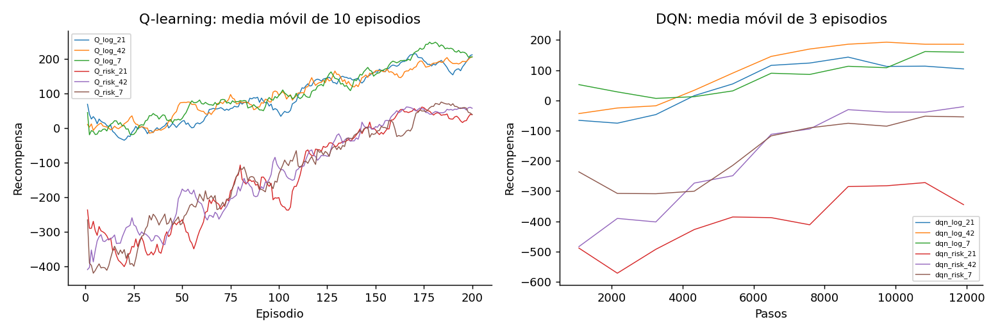
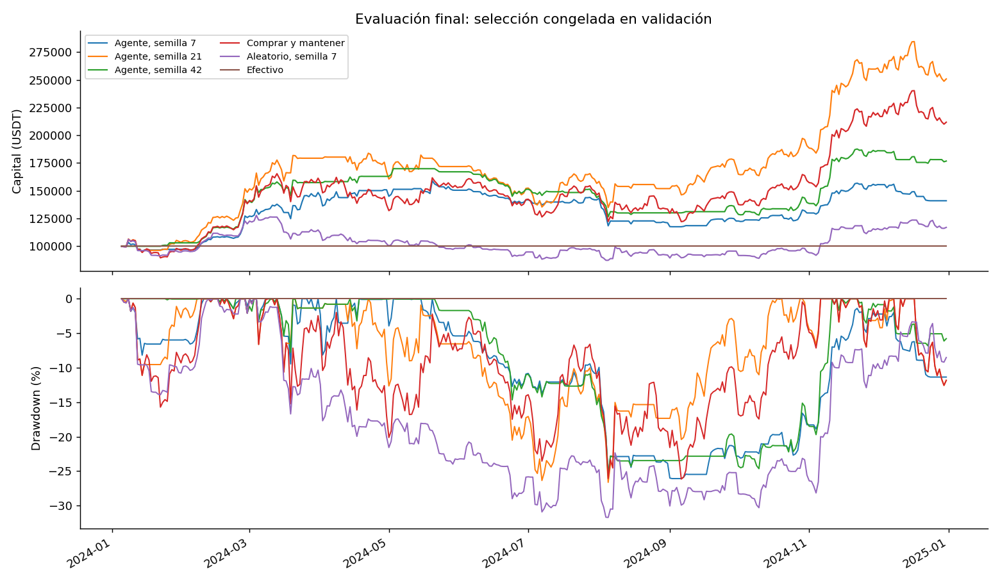

# Aprendizaje por refuerzo para decidir la exposición a BTC/USDT

## Alcance y pregunta de investigación

¿Puede un agente aprender una política que supere a comprar y mantener fuera del entrenamiento, después de pagar costos y considerar las pérdidas? Se implementaron Q-learning tabular y DQN con acciones de 0 %, 50 % y 100 %. El capital inicial fue de 100.000 unidades de cotización, aquí USDT. No se realiza conversión a pesos colombianos.

El candidato elegido en validación fue DQN con recompensa log. En prueba obtuvo un retorno medio de 89.49%; comprar y mantener obtuvo 111.76%. La diferencia fue -22.27 puntos porcentuales. El drawdown medio del agente fue -26.11%, frente a -26.15% del baseline. Estos valores describen una ventana histórica; no prueban superioridad en otros periodos.

## Datos y separación temporal

Se utilizaron 1.827 velas diarias de BTC/USDT del mercado spot de Binance, del 1 de enero de 2020 al 31 de diciembre de 2024. La página de Gym Trading Env facilitada para el trabajo documenta la descarga de criptomonedas con CCXT. Este proyecto usa el endpoint público REST de Binance para conservar una instantánea CSV sin añadir ese paquete. La referencia orienta la fuente; no es un archivo de precios entregado por el profesor.

Cada timestamp identifica el comienzo de la vela UTC. El cierre y los indicadores de esa fila se consideran conocidos al terminar el día. Las fechas del informe son etiquetas de velas, no horas de disponibilidad intradía. El volumen corresponde a BTC. El CSV y sus metadatos están incluidos; repetir el experimento no requiere red.

Tras descartar las primeras 20 observaciones de calentamiento, la división cronológica es 60 % / 20 % / 20 %:

- train: 2020-01-21 a 2023-01-08, 1083 transiciones.
- validation: 2023-01-09 a 2024-01-04, 360 transiciones.
- test: 2024-01-05 a 2024-12-31, 361 transiciones.

Las transiciones entre particiones se excluyen: cada periodo inicia con efectivo y termina en su último precio. Una media móvil de validación o prueba puede usar precios anteriores ya conocidos. Ninguna transición de entrenamiento utiliza un precio de validación. La media y la desviación del escalamiento se ajustan exclusivamente en entrenamiento; después quedan fijas. No se barajan las filas.

SHA-256 del CSV: `e6fd2cbc5efb5876adc084214ec67c1c2f8b190b77a3fe09d8a3e595fcdccfcc`.

## Formulación del proceso de decisión

La observación tiene siete componentes. El retorno de una sesión resume el movimiento reciente. Los retornos de 5 y 20 sesiones describen tendencias de distintas duraciones. La diferencia relativa entre precio y media de 20 sesiones mide separación frente al nivel reciente. La desviación de los retornos de 20 sesiones aproxima la variabilidad. El peso actual informa cuánto capital ya está invertido y el drawdown indica la pérdida respecto al máximo del patrimonio.

Los cinco indicadores de mercado se estandarizan con el entrenamiento y se limitan al intervalo [-10, 10]. El peso pertenece a [0, 1] y el drawdown a [-1, 0]. Las ventanas usan únicamente precios hasta t, sin centrado ni relleno hacia atrás. La observación es una representación parcial del mercado. No se demuestra la propiedad de Markov: variables externas y regímenes ocultos pueden afectar al precio siguiente.

La acción a pertenece a {0, 1, 2} y determina el peso objetivo w en {0, 0,5, 1} después de pagar la comisión. Esta discretización permite comparar Q-learning y DQN. Se admiten participaciones fraccionarias. No hay ventas en corto ni apalancamiento. Tampoco hay posiciones intermedias distintas de 50 %, órdenes límite, intereses sobre efectivo o impacto de mercado.

## Entorno y contabilidad

Al finalizar la vela t, el agente observa el estado, solicita una exposición y el simulador ejecuta al precio de cierre t. Luego valora la posición al cierre t+1 y entrega la recompensa. Se trata de una ejecución idealizada al mismo cierre observado. No usa el cierre t+1 para elegir la acción, pero supone una liquidez y un precio de ejecución que no están garantizados en una operación real. Evaluar con ejecución en la apertura siguiente y datos consistentes de OHLC sería una extensión necesaria antes de interpretar los resultados como operables.

Sea V el patrimonio antes de operar, B el valor del activo antes del rebalanceo, X el valor del activo tras operar y c = 0.0010. Se resuelve X = w[V - c|X-B|]. El costo monetario es C = c|X-B| y el efectivo restante es V-C-X. En compras, X = w(V+cB)/(1+wc); en ventas, X = w(V-cB)/(1-wc). Esto evita invertir todo el patrimonio y pagar la comisión con un saldo negativo.

Si R = p(t+1)/p(t)-1, entonces V(t+1) = V-C+XR. El peso deriva con el precio: mantener la misma acción 50 % puede exigir operar de nuevo. El costo depende del volumen monetario negociado, no de si cambió la etiqueta de acción. Comprar y mantener paga su compra inicial y conserva el activo. Todos comienzan en efectivo, pagan la misma tasa y se valoran a mercado al final, sin venta terminal obligatoria. El drawdown incluye el capital inicial.

La serie de mercado es exógena: las decisiones del agente no afectan el precio. El episodio termina al agotar las transiciones del periodo. El simulador implementa reset y step de Gymnasium y supera el comprobador de Stable-Baselines3.

## Diseño e iteración de la recompensa

La versión inicial es r1 = 100 log[V(t+1)/V(t)]. Incluye las comisiones dentro del patrimonio. La suma de log-retornos equivale al logaritmo del crecimiento acumulado, pero no penaliza por separado la exposición a pérdidas diarias.

La versión revisada es r2 = 100 {log[V(t+1)/V(t)] - lambda × min(g, 0)^2}, con g = V(t+1)/V(t)-1 y lambda = 10.0. El segundo término penaliza pérdidas netas grandes. El factor 100 es fijo en ambas versiones y solo cambia la escala. La penalización adicional cambia el objetivo económico y puede favorecer quedarse en efectivo.

Se entrenó primero la versión log y después la versión risk de cada algoritmo. La comparación utiliza validación; lambda y el presupuesto de entrenamiento se fijaron antes de abrir la prueba. Para DQN, log presentó retorno medio 88.07%, drawdown -17.17% y tiempo en efectivo 20.56%. Risk presentó retorno 75.99%, drawdown -19.02% y tiempo en efectivo 18.80%. Esos datos permiten revisar si el cambio redujo pérdidas o si restringió demasiado la participación.

La hipótesis de la segunda versión fue controlar las pérdidas diarias; no se afirma que su coeficiente sea óptimo. Las diferencias entre versiones son evidencia descriptiva de esta ejecución, no una prueba causal aislada de la penalización.

| Método | Recompensa | Retorno | Drawdown | Costos | Tiempo en efectivo | Puntaje |
|---|---|---|---|---|---|---|
| DQN | log | 88.07% | -17.17% | 5,415.65 | 20.56% | 0.794849 |
| DQN | risk | 75.99% | -19.02% | 5,110.04 | 18.80% | 0.664757 |
| Q-learning | log | 51.56% | -11.80% | 12,046.45 | 57.04% | 0.456628 |
| Q-learning | risk | 50.40% | -9.90% | 10,245.29 | 70.00% | 0.454459 |

Las barras de error representan una desviación estándar muestral del puntaje entre semillas. No son intervalos de confianza sobre mercados futuros.

Un puntaje alto de recompensa no basta para preferir una estrategia: quedarse fuera del mercado puede evitar penalizaciones y perder una subida. Por eso se reportan métricas monetarias, exposición y operaciones. No se identificó una explotación contable del entorno en las pruebas; eso no descarta otros comportamientos no deseados.

## Algoritmos y entrenamiento

Q-learning utiliza una tabla de 243 estados y 3 acciones. Discretiza momentum de 5 y 20 días y volatilidad estandarizados con cortes -0,5 y 0,5; el peso con 0,25 y 0,75; y el drawdown con -0,15 y -0,05. Descarta dos indicadores del estado completo para contener el número de celdas. Usa alpha = 0,1, gamma = 0,99 y 200 episodios completos. Epsilon baja linealmente de 1 a 0,05 en el primer 80 % de episodios. En evaluación se elige argmax; los empates favorecen la acción cero, lo cual puede sesgar estados sin visitas hacia efectivo.

DQN aproxima Q(s,a) con una red de siete entradas, dos capas ocultas de 64 unidades con ReLU y tres salidas. Usa CPU y una hebra de PyTorch. Hiperparámetros: learning rate 0.0003, batch 64, gamma 0.99, replay buffer 20000, inicio del aprendizaje en el paso 500, un gradiente cada 4 pasos y copia de la red objetivo cada 500 pasos. La exploración epsilon baja de 1 a 0,05 durante el primer 40 % de 12000 pasos. Se detiene al agotar ese presupuesto, sin parada temprana basada en prueba. Se guarda el último modelo.

Semillas de entrenamiento y del baseline aleatorio: [7, 21, 42]. La política de evaluación DQN es determinista. Las semillas replican la inicialización y la exploración, no crean nuevos mercados independientes. El número de interacciones de Q-learning es 200 × 1083; el de DQN es 12000. La comparación no iguala el presupuesto de cómputo. Repetir episodios reutiliza el mismo recorrido histórico y puede producir memorización.

Las curvas muestran una media móvil dentro de cada entrenamiento. Sus alturas no comparan directamente objetivos distintos: risk resta una penalización que log no contiene. Mejorar la recompensa de entrenamiento tampoco demuestra que el agente generalice, como muestra la diferencia entre validación y prueba.

## Protocolo de evaluación

Se entrenan cuatro candidatos: cada algoritmo con cada recompensa. La regla de selección, fijada antes de prueba, es la media entre semillas de retorno de validación menos 0,5 veces el valor absoluto del drawdown máximo de validación. Este coeficiente expresa una preferencia explícita por limitar pérdidas; otra preferencia podría elegir otro candidato.

El archivo selection_frozen.json conserva la selección antes de ejecutar los recorridos finales. Se elige una combinación de algoritmo y recompensa, sin escoger la semilla ganadora. No se reentrena con validación. Se evalúan sus tres réplicas en prueba y también se muestran los otros candidatos como auditoría descriptiva. Sus resultados finales no cambian la selección ni los parámetros.

Los baselines son comprar y mantener, aleatorio uniforme entre las tres acciones y efectivo. Comparten fechas, capital inicial y comisiones. Comprar y mantener y efectivo tienen un solo recorrido porque no dependen de semillas. Se reporta la media y la desviación estándar muestral entre semillas; esta dispersión no es un intervalo de confianza sobre mercados futuros. No se realizan pruebas de significancia con esas tres réplicas como si fueran trayectorias independientes.

## Resultados fuera de muestra

| Estrategia | Retorno medio | DE retorno | Drawdown medio | Costos medios | Operaciones medias | Réplicas |
|---|---|---|---|---|---|---|
| Comprar y mantener | 111.76% | No aplica | -26.15% | 99.90 | 1.0 | 1 |
| Efectivo | 0.00% | No aplica | 0.00% | 0.00 | 0.0 | 1 |
| DQN / log | 89.49% | 55.99% | -26.11% | 7,885.40 | 133.0 | 3 |
| DQN / risk | 89.14% | 19.64% | -26.43% | 8,002.27 | 127.3 | 3 |
| Q-learning / log | -3.56% | 9.54% | -23.49% | 11,696.24 | 224.0 | 3 |
| Q-learning / risk | -4.35% | 5.64% | -14.17% | 7,015.43 | 121.3 | 3 |
| Aleatorio | 11.91% | 19.29% | -35.20% | 17,416.71 | 283.3 | 3 |

Los costos están expresados en USDT nominales acumulados. Un drawdown de -20 % corresponde a una caída del 20 % desde un máximo. La desviación entre semillas puede ser cero si todas convergen a la misma política. La recompensa total no se compara directamente entre log y risk, pues miden objetivos distintos.

El agente seleccionado pagó 7,885.40 USDT de costos medios, frente a 99.90 de comprar y mantener. La comparación debe considerar conjuntamente retorno y drawdown: una mejora de un indicador con deterioro del otro no implica dominar al baseline.

En 1 de las 3 semillas el agente seleccionado superó el retorno de comprar y mantener. Sus retornos variaron de 40.98% a 150.75%. Esa amplitud muestra que la conclusión cambia si se publica solo una semilla. La diferencia media fue -22.27 puntos porcentuales. En esta ventana, el promedio no respalda una mejora del agente seleccionado sobre comprar y mantener.

El cambio de validación a prueba también produjo un fallo de generalización observable: Q-learning con recompensa log pasó de un retorno medio de 51.56% a -3.56%. Esta comparación no mantiene fijo el mercado, por lo que no permite identificar la causa. Sí muestra que un resultado favorable en validación no asegura que la política conserve su desempeño después.

### Comportamiento observado y anomalías

Semilla 7: 38.0% de decisiones con exposición cero, exposición objetivo media 43.5%. Peor transición: 2024-08-04 a 2024-08-05, acción 2, retorno neto -7.12%. Semilla 21: 19.4% de decisiones con exposición cero, exposición objetivo media 78.9%. Peor transición: 2024-01-11 a 2024-01-12, acción 2, retorno neto -7.67%. Semilla 42: 51.8% de decisiones con exposición cero, exposición objetivo media 35.7%. Peor transición: 2024-08-04 a 2024-08-05, acción 2, retorno neto -7.17%.

Como diagnóstico reproducible, cada CSV conserva la decisión, el retorno siguiente, la comisión y la exposición. El peor paso anterior permite revisar una pérdida concreta. Una política con exposición casi constante también merece revisión: puede haber aprendido una solución sencilla o haber dejado de distinguir estados. La causa no puede atribuirse a una sola variable sin nuevos experimentos realizados sobre entrenamiento y validación.

## Análisis exploratorio

El cuaderno notebooks/eda.ipynb analiza solo entrenamiento en su configuración inicial. Incluye precio, distribución de retornos, volatilidad móvil, drawdown del activo, volumen e indicadores. Se reserva el EDA completo para la descripción posterior al cierre del experimento. La siguiente figura reúne todo el historial y no se utilizó para seleccionar modelos.

Los retornos y la volatilidad se construyen con ventanas móviles para que el estado no dependa del nivel absoluto de BTC. La exposición y el drawdown añaden información del portafolio que el precio no describe. El volumen se analiza, pero se excluye del estado para mantener una representación pequeña. El archivo eda_train_summary.csv contiene estadísticas calculadas únicamente con entrenamiento.

En entrenamiento, el cierre mínimo fue 4,800.00 USDT y el máximo 67,525.83 USDT. La mayor caída diaria fue -39.50%, en la vela 2020-03-12. El drawdown máximo del precio fue -76.63%. Por eso una recompensa basada solo en crecimiento no describe toda la experiencia de pérdidas del inversionista.

La volatilidad móvil de 20 días alcanzó 11.16% diario el 2020-03-30 y bajó hasta 0.82% el 2023-01-08. Estos cambios justifican observar volatilidad en vez de asumir un riesgo constante. El volumen diario mediano fue 65,828.66 BTC. La correlación de momentum a 20 días con la distancia a su media fue 0.868, lo que indica información parcialmente redundante.

## Limitaciones y respuesta a la pregunta

En esta ejecución, la diferencia media de retorno del candidato seleccionado respecto a comprar y mantener fue -22.27 puntos porcentuales. El resultado debe leerse junto con el riesgo y los costos de la tabla. No autoriza a afirmar que RL sea superior en mercados financieros en general. El baseline efectivo obtuvo 0.00%, lo que ayuda a detectar si operar destruyó capital.

El estudio usa un activo y una sola división temporal. El periodo final puede favorecer un régimen particular; una evaluación walk-forward en nuevos periodos ayudaría a estimar estabilidad. No incluye spread, deslizamiento, impuestos o restricciones de tamaño de orden. El efectivo no gana intereses y USDT se trata como unidad estable. La ejecución al mismo cierre observado es una aproximación optimista. Los datos de una bolsa no representan todos los mercados.

No se recibieron la rúbrica completa ni un CSV común del profesor. Antes de entregar, debe comprobarse si se exige otro activo o periodo. En ese caso, se cambia el CSV y se registra un experimento nuevo; el periodo final de este experimento ya fue observado y no debe reutilizarse para ajustar parámetros.

## Reflexión sobre el experimento y guía para la reflexión individual

El contraste que merece mayor revisión es la variación entre semillas: 40.98% frente a 150.75% para el mismo algoritmo, datos y recompensa. Escoger el mejor recorrido habría contado una historia distinta a la media de las réplicas. La reflexión personal puede explicar si esta diferencia coincidió con lo que se esperaba antes de ejecutar.

La separación de validación y prueba cambió la interpretación del resultado. El candidato se eligió por validación y conservó esa condición aun cuando su media final quedó por debajo de comprar y mantener. La recompensa de riesgo tampoco aseguró una mejora: los resultados de validación muestran que penalizar pérdidas no basta para controlar todos los cambios de exposición. No se midió de forma aislada qué decisión tuvo el mayor efecto causal.

Una repetición podría usar varios cortes walk-forward con presupuestos de interacción equivalentes entre métodos. Antes de entrenar habría que fijar periodos, métricas y regla de selección. La ejecución en la apertura siguiente permitiría estudiar cuánto depende el resultado del supuesto de operar al mismo cierre observado.

No está completamente explicada la diferencia de exposición entre semillas DQN. Los registros permiten localizar cuándo ocurre, pero no identificar por sí solos si nace de la inicialización, la exploración o la cobertura de estados. Una comprobación sería fijar una de esas fuentes de variación en entrenamiento y cambiar otra, manteniendo intacta una nueva prueba futura.

La aplicación financiera añade una dificultad que un entorno didáctico puede ocultar: repetir episodios reproduce la misma historia y no genera mercados nuevos. El agente puede mejorar su recompensa sobre ese recorrido sin aprender una política estable fuera de él. Las comisiones convierten parte de la actividad aparente en pérdida de capital y obligan a revisar el comportamiento, no solo la recompensa.

Para la entrega individual, estas observaciones deben adaptarse a la experiencia de quien presenta. Conviene responder con palabras propias qué resultado sorprendió, qué decisión cambiaría y qué comportamiento sigue sin comprender; no atribuirse pruebas o vivencias que no se realizaron.

## Reproducción y archivos de evidencia

Desde la carpeta del proyecto: python -m pip install -r requirements.txt; python -m unittest discover -s tests -v; python -m src.train --config configs/default.json --output results/replica_01. Los comandos detallados están en README.md. No se necesita descargar datos para reproducir esta instantánea.

Cada ejecución guarda modelos, escalador, configuración, versiones, hash del dataset y métricas por semilla. Los archivos test_*.csv permiten recalcular las métricas y reconstruir los gráficos. Las curvas de aprendizaje DQN están en models/*_monitor.csv; las de Q-learning en learning_*.csv. Los errores de red o dependencias no se sustituyen por datos inventados.

## Referencias

- Sutton, R. S., y Barto, A. G. (2018). Reinforcement Learning: An Introduction, segunda edición. https://incompleteideas.net/book/the-book-2nd.html
- Mnih, V., et al. (2015). Human-level control through deep reinforcement learning. https://doi.org/10.1038/nature14236
- Stable-Baselines3. Documentación DQN. https://stable-baselines3.readthedocs.io/en/master/modules/dqn.html
- Gymnasium. API Env. https://gymnasium.farama.org/api/env/
- Gym Trading Env. Download market data. https://gym-trading-env.readthedocs.io/en/latest/download.html
- Binance. Documentación de velas del API spot. https://developers.binance.com/docs/binance-spot-api-docs/rest-api/market-data-endpoints#klinecandlestick-data
